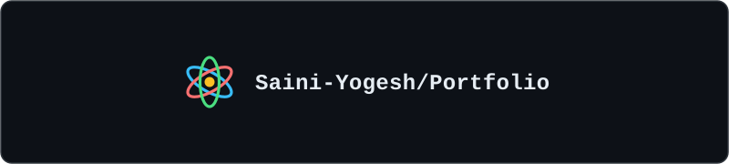

<h1 align="center">Hi 👋, I'm Yogesh Saini</h1>

<h3 align="center">Software Engineer • Backend • Full Stack • Data Engineering</h3>

  

  
  
  

  
  
  

  <a href="https://saini-yogesh.github.io/Portfolio/">
    <picture>
      <source media="(prefers-color-scheme: dark)" srcset="./assets/portfolio-dark.svg" />
      <source media="(prefers-color-scheme: light)" srcset="./assets/portfolio-light.svg" />
      
    </picture>
  </a>

---

  🎓 B.Tech Graduate, <b>NIT Rourkela</b> 
  💼 Now working as <b>Full-Stack Developer</b> 
  💼 Ex Data Engineering Intern @ <b>Vivriti Capital</b> 
  💻 Ex Full-Stack Developer Intern 
  🏆 <b>LeetCode Knight (1891)</b> • <b>Codeforces Specialist (1470)</b>

---

<h2 align="center">🛠 Tech Stack</h2>

  
  
  
  
  
  
  
  
  
  
  
  
  
  
  
  
  
  
  
  
  
  
  
  
  
  
  
  
  
  
  
  
  
  
  
  
  

---

<h2 align="center">🌐 Live in Production</h2>

  <b><a href="https://segment-tree-visualization.vercel.app/">Segment Tree Visualizer</a></b> (<a href="https://github.com/Saini-Yogesh/segment-tree-visualization">GitHub</a>) — Interactive DSA visualization tool actively used by learners to step through range queries, point updates, and lazy propagation in real time.  
  <b><a href="https://rajasthanconnect.in">Rajasthan Connect</a></b> (<a href="https://github.com/Saini-Yogesh/rajasthanconnect">GitHub</a>) — Live full-stack platform serving real users in production, engineered end-to-end for performance and reliability.

  🤝 <b>Open to Open-Source Contributions</b> (PRs & contributors welcome!) • 💼 <b>Available for Freelancing</b> 

---

<h2 align="center">📊 GitHub Stats</h2>

  <picture>
    <source media="(prefers-color-scheme: dark)" srcset="https://github-readme-stats.vercel.app/api?username=Saini-Yogesh&show_icons=true&theme=github_dark&bg_color=0d1117&border_color=30363d&card_width=405" />
    <source media="(prefers-color-scheme: light)" srcset="https://github-readme-stats.vercel.app/api?username=Saini-Yogesh&show_icons=true&theme=default&card_width=405" />
    
  </picture>
  <picture>
    <source media="(prefers-color-scheme: dark)" srcset="https://github-readme-stats.vercel.app/api/top-langs/?username=Saini-Yogesh&layout=compact&langs_count=8&theme=github_dark&bg_color=0d1117&border_color=30363d&card_width=405" />
    <source media="(prefers-color-scheme: light)" srcset="https://github-readme-stats.vercel.app/api/top-langs/?username=Saini-Yogesh&layout=compact&langs_count=8&theme=default&card_width=405" />
    
  </picture>

  <picture>
    <source media="(prefers-color-scheme: dark)" srcset="https://github-readme-streak-stats.herokuapp.com/?user=Saini-Yogesh&background=0d1117&border=30363d&stroke=30363d&ring=58a6ff&fire=58a6ff&currStreakNum=e6edf3&sideNums=e6edf3&currStreakLabel=58a6ff&sideLabels=8b949e&dates=8b949e" />
    <source media="(prefers-color-scheme: light)" srcset="https://github-readme-streak-stats.herokuapp.com/?user=Saini-Yogesh&theme=default" />
    
  </picture>

If you like it, do fork 🍴 and star ⭐

